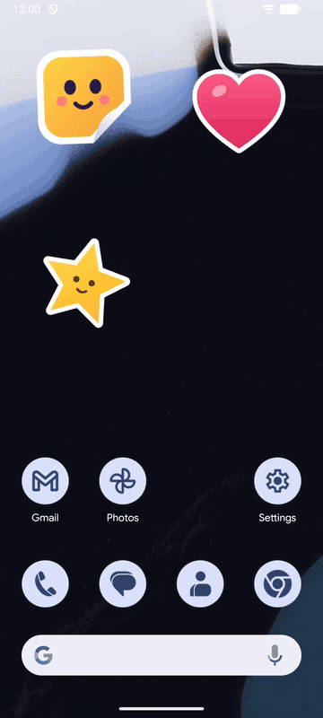
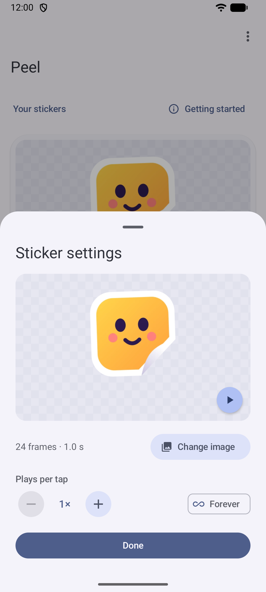
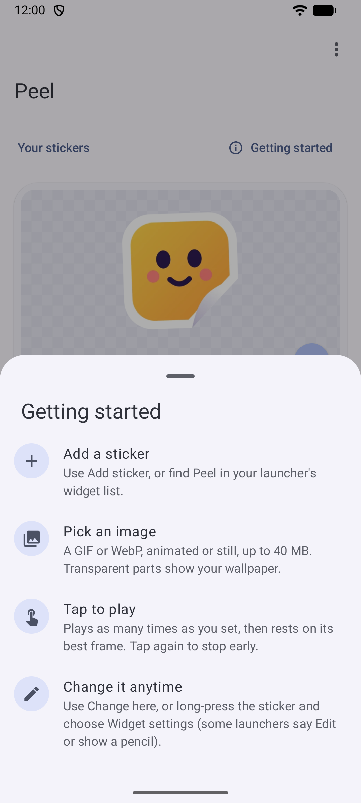
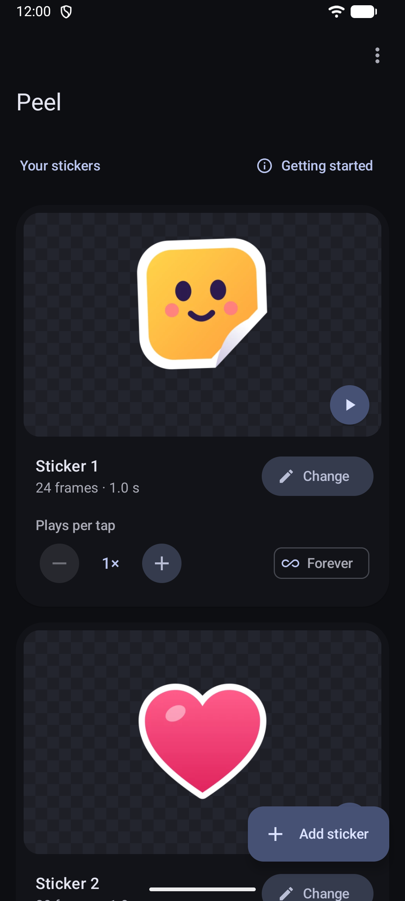

<div align="center">


# Peel: Sticker Widget

**Transparent, tap-to-play stickers for your Android home screen.**

[](LICENSE)
[](#download)
[](https://developer.android.com/compose)

Peel turns any GIF or WebP into a sticker on your home screen. Transparent parts show your
wallpaper, so there's no box or background, just the sticker. Tap it to play.

<a href="https://github.com/VipinVIP/Peel/releases/latest"></a>

<sub>Requires Android 12 or newer.</sub>

</div>

## Demo and screenshots

<div align="center">




<br>
<sub>Left: tap stickers to play them together, then set how many times each one plays (<a href="docs/demo.mp4">MP4</a>).</sub>
</div>

## Features

- **Truly transparent:** only the image itself is drawn on your home screen
- **Tap to play:** choose 1–50 plays per tap, or loop until you tap again
- **Play together:** several stickers can animate at the same time
- **GIF and WebP:** animated or still, up to 40 MB
- **Material You:** dynamic color from your wallpaper, light and dark theme
- **Private:** no internet permission, ads or tracking; your images never leave your phone

## How it works

1. **Add a sticker:** tap *Add sticker* in the app, or find *Peel sticker* in your launcher's widget list.
2. **Pick an image:** choose a GIF or WebP from your phone.
3. **Tap to play:** the sticker plays as many times as you set, then rests on its best frame.
4. **Change it anytime:** use *Change* in the app, or long-press the sticker and choose *Widget settings*.

## Building

```bash
./gradlew assembleRelease
```

The APK is written to `app/build/outputs/apk/release/`.

The app ships a [baseline profile](https://developer.android.com/topic/performance/baselineprofiles/overview)
for faster startup. To regenerate it after changing startup code, run
`./gradlew :app:generateReleaseBaselineProfile` with a device connected. The profiling tool needs
Android 13 or newer on that device; the app itself runs on Android 12+.

## Contributing

Bug reports, ideas and pull requests are welcome. Please [open an issue](https://github.com/VipinVIP/Peel/issues) first for larger changes.

## License

Peel is released under the [MIT License](LICENSE). © 2026 VipinVIP
